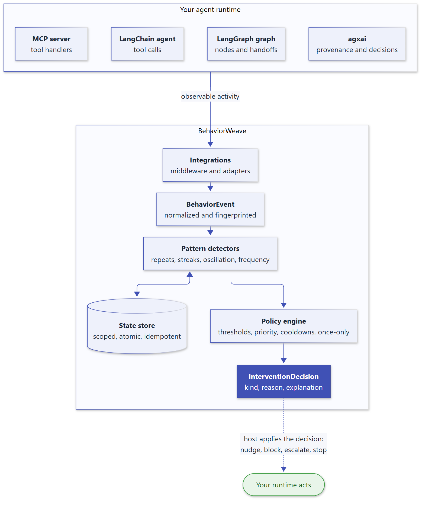

# BehaviorWeave

**Deterministic behavioral policies and interventions for LangGraph and LangChain agents.**

Agents loop. They call the same tool with the same arguments, retry a failing dependency,
bounce work between two agents, or press on through a failure streak. BehaviorWeave watches
observable runtime activity, detects these patterns deterministically, and returns a typed
intervention, such as *nudge*, *escalate*, *human review*, or *stop*, that your application
applies.



<div class="grid cards" markdown>

-   :material-scale-balance: **Deterministic and explainable**

    ---

    The same events always produce the same decision, with the pattern, count, threshold,
    and policy that caused it. No model calls, no heuristics.

-   :material-puzzle-outline: **Framework-native**

    ---

    One line of middleware guards every tool call of a LangChain agent. Adapters cover
    LangGraph nodes, multi-agent handoffs, MCP servers, and agxai provenance.

-   :material-shield-lock-outline: **Correct under pressure**

    ---

    Scope isolation, idempotent redelivery, and atomic state transitions: a once-only
    policy fires exactly once even when concurrent workers race.

-   :material-steering: **Your runtime stays in control**

    ---

    The engine returns decisions; it never stops, reroutes, or mutates your graph. You
    decide what a `stop` or `human_review` means, or let the LangChain middleware refuse
    blocked tool calls for you.

</div>

## At a glance

```python
from behaviorweave import (
    BehaviorEngine,
    BehaviorEvent,
    InterventionType,
    PolicyRule,
)

engine = BehaviorEngine(
    policies=[
        PolicyRule(
            "repeat-nudge", "repeated_tool_call", 2, InterventionType.NUDGE
        ),
        PolicyRule(
            "repeat-stop", "repeated_tool_call", 3, InterventionType.STOP
        ),
    ]
)

for _ in range(3):
    decision = await engine.process(
        BehaviorEvent.tool_call(
            "get_alarm", {"machine": "ETCH-3"}, scope="incident-42"
        )
    )

assert decision.intervention.kind is InterventionType.STOP
print(decision.intervention.reason)  # 'get_alarm' occurred 3 consecutive times
```

## Built-in patterns

| Pattern ID | Detects |
| --- | --- |
| `repeated_tool_call` | Consecutive calls to the same tool with the same arguments. |
| `repeated_node_execution` | Consecutive executions of the same graph node. |
| `failure_streak` | Consecutive failures, reset by a success. |
| `retry_streak` | Consecutive retries, reset by a success. |
| `success_streak` | Consecutive successes, reset by a failure or retry. |
| `delegation_streak` | Consecutive delegations to the same agent. |
| `oscillation` | Handoffs or delegations bouncing back and forth between two agents. |
| `event_frequency` | Total occurrences of each event identity. |

## Downloads

<p>
  <a href="https://clickpy.clickhouse.com/dashboard/behaviorweave"></a>
  <a href="https://clickpy.clickhouse.com/dashboard/behaviorweave"></a>
  <a href="https://clickpy.clickhouse.com/dashboard/behaviorweave"></a>
  <a href="https://clickpy.clickhouse.com/dashboard/behaviorweave"></a>
</p>
<p>
  <a href="https://clickpy.clickhouse.com/dashboard/behaviorweave"></a>
  <a href="https://clickpy.clickhouse.com/dashboard/behaviorweave"></a>
  <a href="https://clickpy.clickhouse.com/dashboard/behaviorweave"></a>
  <a href="https://clickpy.clickhouse.com/dashboard/behaviorweave"></a>
  <a href="https://clickpy.clickhouse.com/dashboard/behaviorweave"></a>
  <a href="https://clickpy.clickhouse.com/dashboard/behaviorweave"></a>
  <a href="https://clickpy.clickhouse.com/dashboard/behaviorweave"></a>
  <a href="https://clickpy.clickhouse.com/dashboard/behaviorweave"></a>
  <a href="https://clickpy.clickhouse.com/dashboard/behaviorweave"></a>
  <a href="https://clickpy.clickhouse.com/dashboard/behaviorweave"></a>
  <a href="https://clickpy.clickhouse.com/dashboard/behaviorweave"></a>
  <a href="https://clickpy.clickhouse.com/dashboard/behaviorweave"></a>
  <a href="https://clickpy.clickhouse.com/dashboard/behaviorweave"></a>
  <a href="https://clickpy.clickhouse.com/dashboard/behaviorweave"></a>
  <a href="https://clickpy.clickhouse.com/dashboard/behaviorweave"></a>
  <a href="https://clickpy.clickhouse.com/dashboard/behaviorweave"></a>
  <a href="https://clickpy.clickhouse.com/dashboard/behaviorweave"></a>
  <a href="https://clickpy.clickhouse.com/dashboard/behaviorweave"></a>
  <a href="https://clickpy.clickhouse.com/dashboard/behaviorweave"></a>
  <a href="https://clickpy.clickhouse.com/dashboard/behaviorweave"></a>
</p>

Download counts come from the [ClickHouse public PyPI dataset](https://clickpy.clickhouse.com/dashboard/behaviorweave),
which refreshes daily, so counts may be about a day behind. Shields caches badge images for
up to an hour, and GitHub may also cache them. Weeks start on Monday (UTC). Explore
interactive charts on the [ClickPy dashboard](https://clickpy.clickhouse.com/dashboard/behaviorweave).

## Where to next

- [Quickstart](getting-started/quickstart.md): install BehaviorWeave and guard an agent in five minutes.
- [Concepts](guide/concepts/events.md): events, patterns, policies, and state.
- [LangChain middleware](integrations/langchain.md): guard any `create_agent` agent.
- [Examples](examples/index.md): twenty runnable integration and policy scenarios.
- [API reference](api/index.md): every public class and function.
